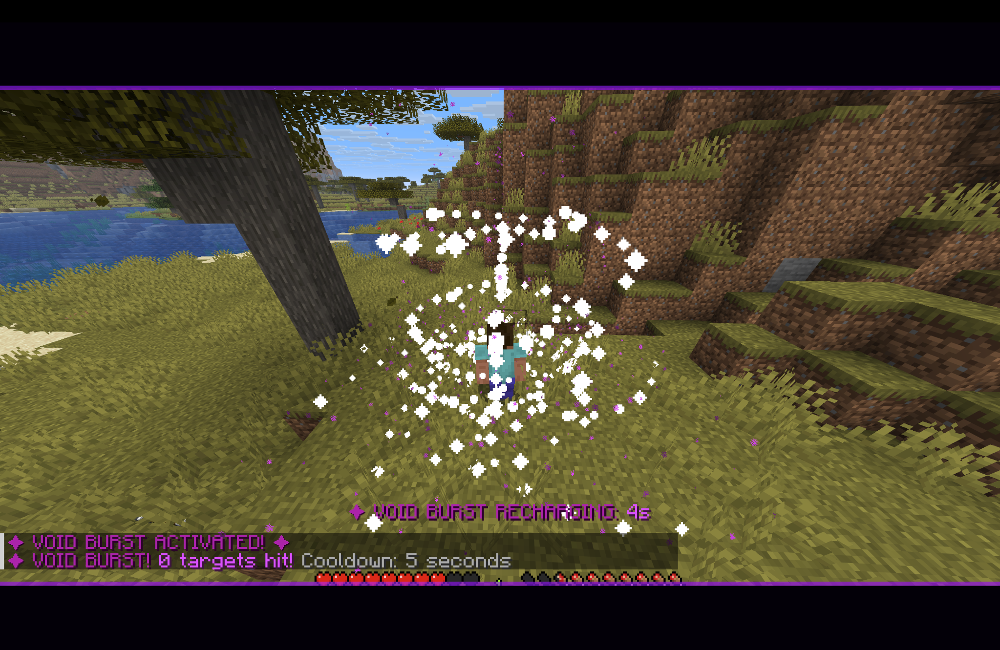
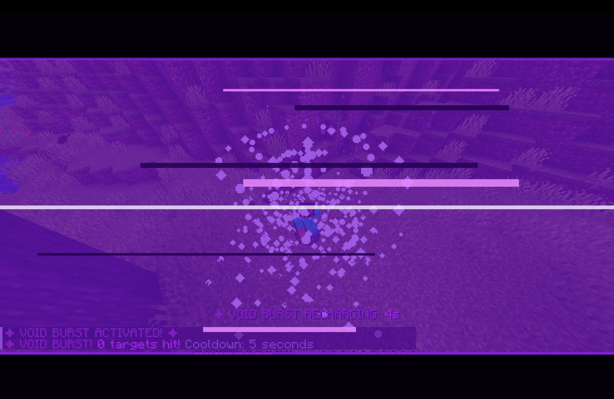
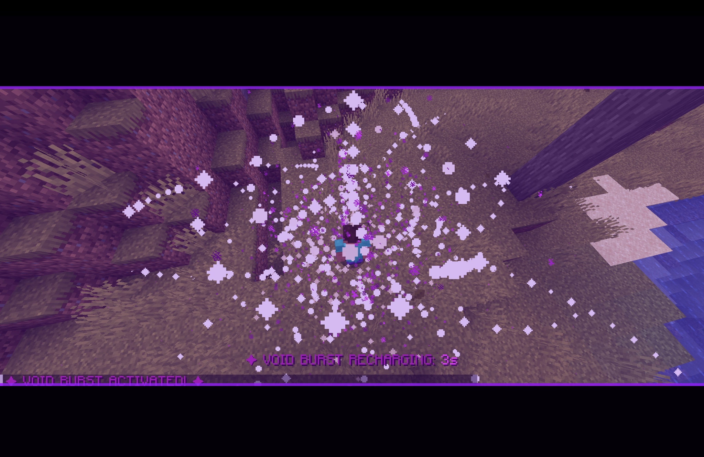

OIDREALM
Unleash the Void. VOIDREALM is a Minecraft Java Edition Fabric mod built around Void Burst — a purple, cinematic area attack with portal energy, a spiraling void gate, an expanding shockwave, and an aftershock.
Status: Personal/learning project. The current build targets Minecraft Java Edition 26.3. Build and test it locally before using it in a world or server.

Features
- Void Burst ability activated with the G key by default.
- Area attack that can damage and knock back multiple nearby living entities.
- Cinematic visual sequence: collapsing energy rings, a spiraling vortex, intersecting portal rings, a void eruption, an expanding shockwave, and fading aftershock particles.
- Screen effects: violet impact flash, animated reality-tear bands, and cinematic bars.
- Cooldown feedback with an on-screen countdown and a ready message.
- Server-side attack handling so damage and knockback are not just visual client particles.
- 
Compatibility
Requirement	Version
Minecraft: Java Edition	26.3
Java	25 or newer
Fabric Loader	0.19.5 or newer
Fabric API	Matching Minecraft 26.3 build

These versions match the current project configuration. If you change the Minecraft version, update and test the related Fabric dependencies too.
Build from source
You need Git, Java 25+, and an internet connection for Gradle to download project dependencies.
git clone https://github.com/Hesandu-Ruwanpathirana/VOIDREALM.git
cd VOIDREALM
./gradlew build
On Windows, use:
gradlew.bat build
When the build succeeds, look in build/libs/ for the mod JAR. Choose the normal mod JAR, not a -sources.jar file. The project also includes the usual Fabric Loom development setup, so you can open it in IntelliJ IDEA and use the Gradle tasks to run a development client.

Install and play
1. Install Minecraft Java Edition 26.3 and a compatible Fabric Loader.
2. Install the Fabric API build made for Minecraft 26.3.
3. Build VOIDREALM using the instructions above.
4. Place the normal VOIDREALM JAR in the Minecraft mods folder.
5. For multiplayer, install the same compatible VOIDREALM build and Fabric dependencies on the server as well as on each client.
6. Launch the game and press G to activate Void Burst.

The key can be changed in Minecraft's Options → Controls → Key Binds if the key mapping is listed there.
Ability notes
- Default key: G
- Cooldown: 5 seconds
- Area radius: 7 blocks in the current server-side configuration
- Base damage: 8 damage points in the current server-side configuration (equivalent to 4 hearts before armor and other damage effects)
- Targets: nearby living entities other than the activating player; passive mobs and other players may also be affected if they are in range
Balance values may change as the mod develops. Armor, damage immunity, entity behavior, and server conditions can affect the result of an attack.

Project layout
src/
├── main/java/com/voidrealm/
│   ├── VOIDREALM.java             # Server-side attack, damage, knockback, cooldown
│   └── VoidBurstPayload.java      # Client-to-server ability payload
└── client/java/com/voidrealm/client/
    ├── VOIDREALMClient.java       # Keybind, client networking, cooldown display
    ├── VoidBurstAnimation.java    # Timed particle sequence
    └── VoidBurstScreenEffects.java # Cinematic HUD overlays and impact flash

## 🎮 Visual Output

### 🌀 Void Vortex

### 💥 Reality Break

### ✨ Animation

Troubleshooting
- Pressing G does nothing: confirm VOIDREALM and Fabric API are installed and enabled, and check that the server has the compatible mod installed for multiplayer.
- The game fails to start: confirm you're using Java 25+ and Minecraft 26.3 with compatible Fabric Loader and Fabric API versions.
- The mod does not build: run ./gradlew build and check the first Gradle/compiler error before changing code.
- The attack looks right but enemies aren't affected: verify that the server is running the compatible VOIDREALM build; attack damage and knockback are processed server-side.

License
VOIDREALM is distributed under the MIT License. See LICENSE.

Credits
Built with the Minecraft Java modding ecosystem, Fabric Loader, Fabric API, and Fabric Loom. VOIDREALM is an independent community mod and is not an official Minecraft or Fabric project.
